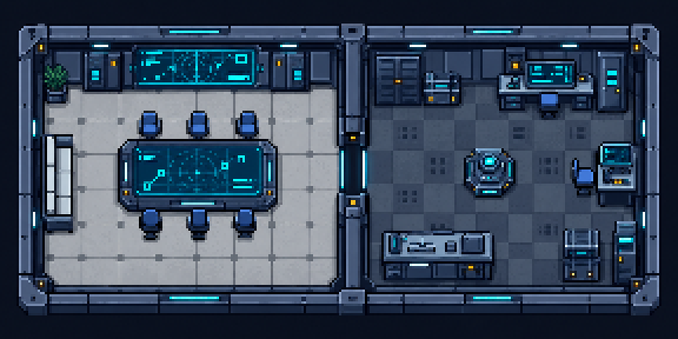

# Avengers Room


Um jogo de investigação 2D para Android. Explore uma sala dos Vingadores, examine pistas, converse com os sobreviventes e descubra quem cometeu o crime. Protótipo não comercial criado para competição.



## Como funciona

1. Uma partida sorteia uma vítima entre cinco personagens e um assassino entre os quatro sobreviventes.
2. Toque no chão para caminhar; aproxime-se de personagens e objetos para interagir.
3. Examine três pistas e entreviste cada sobrevivente em um chat separado.
4. Consulte o caderno, escolha um suspeito e veja a explicação do caso.

O motor do caso define os fatos e o resultado. O Gemini redige as respostas das entrevistas a partir do dossiê permitido para cada personagem. As 20 combinações de vítima e assassino podem ser reproduzidas por sementes de 0 a 19.

## Funcionalidades

- Sala 2D com movimento por toque e interação por proximidade.
- Cinco personagens: Homem de Ferro, Capitão América, Thor, Viúva Negra e Gavião Arqueiro.
- Pistas, caderno, acusação e tela de resultado.
- Entrevistas independentes via Firebase AI Logic/Gemini, com histórico preservado para tentar novamente após falha.
- Perfis públicos da Comic Vine com cache local e crédito da fonte.
- Interfaces em XML para orientação vertical e horizontal.

## Estrutura

```text
.
├── Marvel/                 # Projeto Android Studio
│   ├── app/src/main/java/  # Motor do caso, integrações e interface em Java
│   ├── app/src/main/res/   # Layouts XML, imagens e recursos
│   ├── app/src/main/assets/ # Recursos da sala
│   ├── app/src/test/       # Testes locais
│   ├── artwork/            # Fontes e processamento de arte
│   └── gradlew.bat         # Gradle Wrapper para Windows
├── PLANO.md                # Regras e critérios do protótipo
└── README.md
```

## Executar

**Requisitos:** Android Studio com SDK Android 36.1 e JDK 21; dispositivo ou emulador com Android 7.0 (API 24) ou superior. Abra a pasta `Marvel/` no Android Studio e sincronize o Gradle.

Para habilitar as integrações, configure localmente:

1. Crie um projeto Firebase, registre o app Android `com.projetos.marvel`, habilite Firebase AI Logic e configure App Check conforme o ambiente.
2. Coloque o arquivo `google-services.json` em `Marvel/app/`.
3. Obtenha uma chave da Comic Vine e adicione `COMIC_VINE_API_KEY=sua_chave` em `Marvel/local.properties`.
4. Execute a configuração `app` no dispositivo ou emulador. A demonstração das entrevistas exige rede e as integrações ativas.

`google-services.json` e `local.properties` são ignorados pelo Git. Não envie chaves, tokens ou esses arquivos ao repositório.

Para executar os testes locais no Windows:

```powershell
cd Marvel
.\gradlew.bat :app:testDebugUnitTest
```

## Créditos e uso

Autor: **Rodrigo Bolgheroni**. Perfis online: [Comic Vine](https://comicvine.gamespot.com/api/). Este projeto não é oficial nem afiliado à Marvel. Personagens, marcas e artes de terceiros pertencem aos respectivos titulares; confira as permissões de uso antes de distribuir imagens, vídeo ou APK. A API Comic Vine tem condições próprias para uso não comercial.
